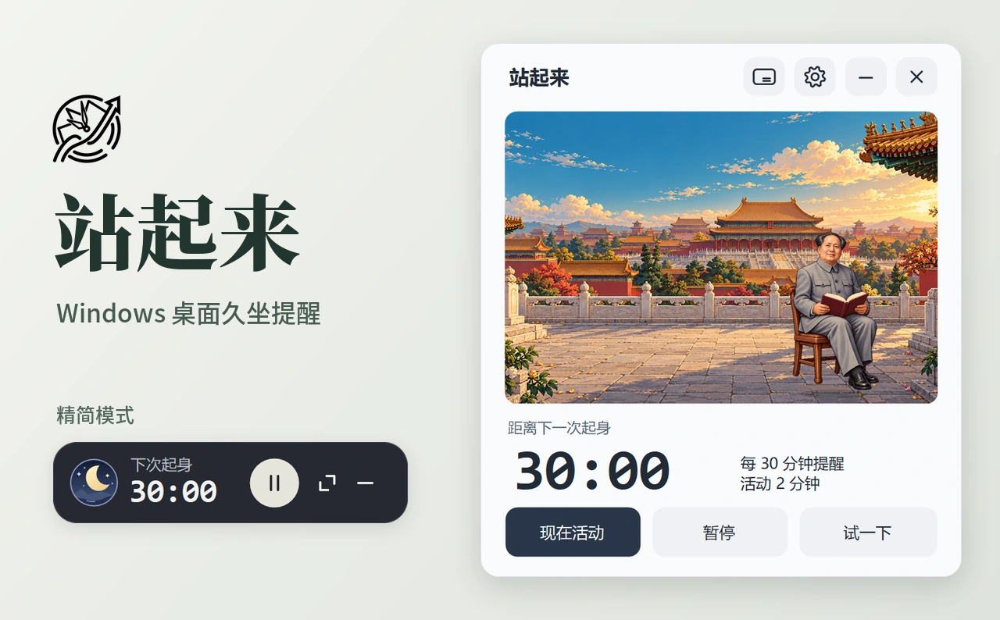

# 站起来 · 桌面小憩

一款 Windows 桌面久坐提醒器。工作时，画面里的人物坐着读书；到了你设定的时间，他会合上书站起来，送上一句鼓励。你也可以把倒计时收成屏幕边缘的一道细线。

**[下载 Windows 免安装版](https://github.com/Vinevil/StandUp/releases/download/v1.8.1/StandUp-1.8.1-Windows.zip)**　·　[版本记录](https://github.com/Vinevil/StandUp/releases)　·　[使用说明](使用说明.md)



## 开始第一轮

1. 下载并解压 ZIP，双击 **站起来.exe**。默认计时 **30 分钟**，活动时长为 **2 分钟**，两项都可在齿轮设置里调整。
2. 想先看看效果，点 **试一下**。人物会站起来，你可以点 **开始活动**，也可以选 **稍后 1 分钟**。
3. 活动结束后，点 **下一轮** 再开始计时。

## 让倒计时待在顺手的位置

| 使用方式 | 在桌面上的样子 |
| --- | --- |
| **主窗口** | 场景、人物和剩余时间一起显示。拖动标题可移动，拖动边角可缩放。 |
| **精简小窗** | 点右上角的小窗图标，只留下倒计时和常用按钮。任务栏腾出位置，通知区域保留时钟图标。 |
| **贴边细条** | 把小窗拖到屏幕边缘松手。左右贴边保留高度，上下贴边保留宽度，鼠标移上去即展开。小窗会避开当前显示器的任务栏。 |

精简或最小化时，到点会弹出带语录的小气泡。想看人物站起，可以在设置里选择到点打开主窗口。

<p align="center"></p>

## 换一幅风景，留一句自己的话

- **场景与人物**　五处场景包括树下、湖边、江南庭院、紫禁城和喜马拉雅山。人物、场景和七套主题可独立搭配。
- **自己的壁纸**　在 **设置 → 选壁纸** 选择本地图片，或把常用图片放进程序旁的 `壁纸` 文件夹。
- **自己的语录**　在 **设置 → 编辑语录** 打开 `quotes.txt`，每行一句，按 UTF-8 保存，下次提醒即会读取。默认 126 条，同一轮抽完再洗牌。

## 运行与构建

适用于 **Windows 10 / 11**，使用系统自带的 .NET Framework。程序离线运行，设置和语录记录保存在程序所在文件夹。精简模式下只更新小窗计时，大场景停止重绘。

在 Windows PowerShell 中进入源码目录，运行：

```powershell
.\build.ps1
```

生成的程序位于 `便携版\站起来.exe`。[使用与自测说明](使用说明.md) · [画面制作说明](docs/artwork.md)

## 素材与语录

场景和角色图集由图像生成工具绘制。动画角色原作及相关标识的权利归相应权利人。历史语录保留作者和出处。[素材与授权说明](NOTICE.md) · [语录出处](语录出处.md)
